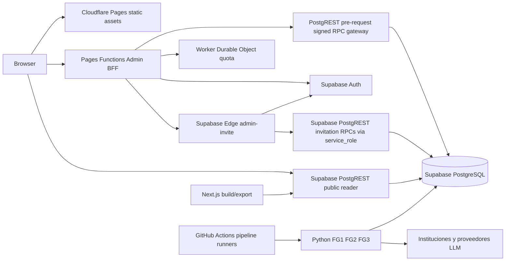
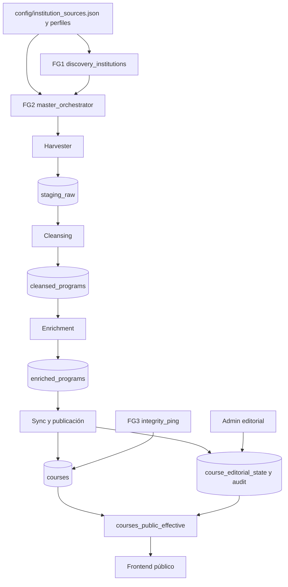

# Arquitectura del sistema

> Estado: descripción de implementación candidata local, corte 2026-10-12. Los diagramas resumen rutas de código y configuración observadas; no demuestran conectividad o adopción remota.

## Límites y runtimes

StudIAMatch se divide en cinco runtimes. El frontend se exporta como archivos estáticos Next.js; las Pages Functions ejecutan el BFF Admin; el Worker con Durable Object conserva contadores de cuota; Supabase ofrece PostgreSQL, Auth, PostgREST y Edge Functions; el pipeline Python se ejecuta en runners GitHub Actions o en Docker local. No hay base de datos local del producto. PostgreSQL 17 se usa únicamente como fixture de prueba desechable.

La página estática se descarga desde Pages; durante uso público el navegador consulta datos efectivos mediante Supabase JS/Data API con publishable key. Separadamente, `next build` consulta PostgREST en `generateStaticParams` y `fetchCourseMeta` para generar rutas y metadata estática; que el build lea DB no significa que Pages estático sea un servidor conectado a DB en runtime. Admin usa el BFF con cookie de sesión HttpOnly y comprobaciones de origen/cookie; el BFF valida el usuario en el mismo proyecto Supabase y limita las RPC a una allowlist. Las llamadas directas `POST /api/admin/rpc` se remapean a `admin_signed_rpc` y llevan firma HMAC verificada por el pre-request de PostgREST. La invitación sigue otro canal: el BFF pasa el JWT de sesión a `admin-invite`; Edge valida la identidad, AAL2 y membresía activa, y después llama las RPC del ciclo de invitación con una API key server-side `service_role` y el actor explícito. El pre-request SQL local retorna temprano para `service_role`, por lo que ese canal no consume el gateway HMAC. Código/migration son locales; configuración, claves y adopción remotas no se consultaron. El Worker de cuota es un binding de runtime interno, distinto del servicio Supabase.

## Datos y dependencias

- El catálogo institucional y sus perfiles gobiernan descubrimiento, exclusiones y elegibilidad del pipeline.
- Datos operativos por ambiente pasan por staging, limpieza y enriquecimiento; el writer normal final es sync. La tarea FG3 mantiene/verifica courses.
- La capa editorial separa valores efectivos/editoriales de campos base del pipeline. La vista pública aplica estado publicado y calidad completa junto con condiciones de curso/institución.
- Admin usa Supabase Auth para identidad y admin_members para rol/actividad. MFA AAL2 se exige para las acciones sensibles configuradas.
- Dependencias externas: páginas/sitemaps institucionales, proveedores LLM en orden con fallback, Cloudflare Pages/Workers, Supabase y GitHub Actions. La configuración local no acredita versiones activas remotas ni disponibilidad de proveedores.

## Compatibilidad, recuperación y puntos de fallo

Las promociones con cambio de contrato siguen expand -> compatibilidad -> deploy -> contract: añadir compatibilidad, comprobar coexistencia, desplegar el consumidor y retirar el contrato viejo solo tras verificar estabilización. El plan de rollback debe ser específico por ambiente y por writer; SQL de rollback no es permiso para ejecutarlo.

Los cortes principales son: export estático sin ruta generada hasta un rebuild; lectura de Supabase fallida o datos públicos no publicados; BFF/DO de cuota sin disponibilidad (fail closed); verificación de sesión, MFA o gateway ausente; fallo de proveedor LLM con fallback agotado; y gates/perfiles de institución que saltan estaciones. Se registran errores/estados en tablas del pipeline, responses HTTP y evidencia de workflow. No se documenta una observabilidad remota consultada en este corte.

## Fuentes

| Afirmación | Fuente local |
|---|---|
| Entrega estática, lectura pública y rutas estáticas | web/next.config.js, web/src/lib/supabase.ts, web/src/app/page.tsx, web/src/app/courses/[institution]/[slug]/page.tsx (`generateStaticParams`, `fetchCourseMeta`), web/functions/_middleware.ts. |
| Transporte Admin y sesiones | web/src/lib/admin-auth.ts, web/functions/_lib/admin-bff.ts, migración 20261004_h3_admin_rpc_signed_gateway_expand.sql. |
| Datos efectivos y pipeline | db/restore_full_schema.sql, migraciones H2/H3, scripts/core/{master_orchestrator,universal_harvester,cleansing_worker,enrichment_worker,sync_vector_worker,integrity_ping}.py. |
| Durables y Edge | workers/admin-quota/index.ts, workers/admin-quota/wrangler.jsonc, supabase/functions/admin-invite/index.ts, supabase/config.toml. |
| Restricciones/ambientes | AGENTS.md, [estado operativo](estado_del_proyecto.md). |
| Validación integrada local | [R178](evidencia/h3req1_g09_local_close_r178_2026-10-11.md), sin prueba de despliegue actual. |

## Navegación relacionada

[Índice principal](indice.md) · [Frontend](frontend.md) · [Backend](backend.md) · [Base de datos](database.md) · [Pipeline](componentes/pipeline.md) · [Seguridad](seguridad.md) · [Pruebas](pruebas.md) · [Operación](operacion.md) · [CI/CD](ci_cd.md) · [Requerimientos](requerimientos/README.md) · [Hitos](hitos/README.md) · [Decisiones](decisiones/README.md)
