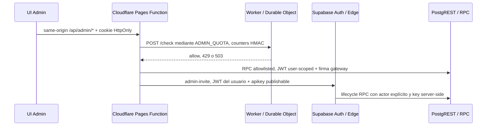

# Componente: runtime server-side de Admin

Esta ficha cubre Pages Functions, cuota Worker/DO, Edge de invitación y los archivos Auth que participan en el flujo. Son runtimes diferentes: no comparten identidad de despliegue ni el mismo contrato privilegiado. El [registro fuente-componente](../trazabilidad/registro_fuentes_componentes.md#runtime-admin) asigna cada path al anchor específico de esta página.

## Límites y recorrido

El diagrama refleja las llamadas estáticas de `web/functions/`, `workers/admin-quota/` y `supabase/functions/admin-invite/`; no demuestra que los bindings o servicios estén desplegados. El BFF directo a PostgREST usa un gateway firmado para la allowlist RPC; el canal Edge de invitaciones valida al usuario y luego usa credencial privilegiada server-side. El canal Edge no usa el HMAC del gateway BFF. Contratos HTTP y autorización SQL se detallan en [Backend](../backend.md#mapa-de-endpoints-admin), [Seguridad](../seguridad.md#modelo-de-confianza-y-permisos) y [Database](../database.md#vistas-funciones-rls-e-indices).

## Middleware y enrutamiento Admin

**Fuentes:** `web/functions/_middleware.ts` (`onRequest`, `isAdminPath`, `isAdminApiPath`, `isEncodedAdminPath`).

El middleware identifica `/admin` y `/api/admin`, rechaza variantes codificadas/normalizadas que podrían evadir la selección de namespace, permite solo hosts de `ADMIN_ALLOWED_HOSTS` y nunca sirve Admin desde los hosts públicos configurados en el código. `ADMIN_BFF_SAFE_SUSPEND=true` responde 503 sin caché y expira cookies Admin; de otro modo, delega a `routeAdminBff`, normaliza algunos trailing slash y continúa con Pages para la ruta estática.

**Entradas/salidas y dependencias:** request HTTP, hostname/path y bindings Pages; devuelve 404/503, respuesta BFF, redirect 302 o `context.next()`. El consumidor local de `/api/admin/*` es `web/src/lib/admin-auth.ts`; las rutas `web/src/app/admin/**` consumen ese cliente. El runtime de Pages descubre el middleware por su convención de carpeta; la selección de ambiente remota queda por verificar.

**Cambio seguro:** revisar rutas de `admin-auth.ts`, middleware, configuración de hosts y tests `h3_admin_bff_mock_uat.mjs`, `h3_local_uat.mjs` y `test_supabase_credentials_contract.py`. Toda variación de host/cookie/método requiere revisar CSRF, safe-suspend, allowlist de transporte y pruebas; no activar flags locales en Cloudflare.

## BFF: cookie y RPC firmada

**Fuentes:** `web/functions/_lib/admin-bff.ts` (`routeAdminBff`, `createCookieState`, `ADMIN_RPC_ALLOWLIST`, `ADMIN_RPC_READS`) y el middleware anterior. El transporte compartido `web/src/lib/supabase-transport.ts` tiene ownership y contrato propios en [Supabase transport](supabase_transport.md#fuentes-y-relaciones); sus dos consumidores locales son el cliente SDK público y este BFF server-side.

El BFF crea cliente SSR en el mismo proyecto Supabase permitido, mantiene access/refresh tokens en cookies `Secure`, `HttpOnly`, host-only y `SameSite=Lax`, aplica timeout de inactividad y cookie de actividad firmada. Las rutas cubren sesión, login/logout, callback PKCE, password, MFA, RPC e invitaciones. Métodos, status, shapes y códigos de error están en el mapa de endpoints de Backend. `ADMIN_RPC_ALLOWLIST` limita el nombre de RPC y `ADMIN_RPC_READS` selecciona clase de cuota; la firma gateway agrega proyecto, key id, actor, RPC y argumentos. La firma solo protege el endpoint RPC directo; la invitación sigue el canal Edge separado.

**Datos y permisos:** el browser ve respuestas normalizadas, nunca el JWT de sesión ni la key server-side. Las variables se documentan por nombre en [Operación](../operacion.md#ambientes-y-datos); no copiar valores a reportes. La SQL local define HMAC, nonce y actor, mientras `pgrst.db_pre_request`/keys remotas requieren comprobación posterior.

**Fallos/recuperación:** configuración incompleta, host/origin inválido, cuota, RPC no allowlisted, MFA/AAL insuficiente y errores del proveedor devuelven códigos acotados; las respuestas no deben filtrar errores crudos. El safe-suspend conserva las páginas públicas y limpia la sesión. Para cambios, revisar Admin UI → `admin-auth.ts` → middleware/BFF → gateway SQL → tests de mock/credenciales/harness; aplicar `expand -> compatibilidad -> deploy -> contract` solo bajo la autorización del paso siguiente.

**D04 — denegación de rol en el lector de membresías (candidato local 2026-10-25):** el wrapper de cuota del RPC `admin_list_members_onboarding` convierte SQLSTATE `42501` en HTTP 403; el guard legacy de la función privada usaba `RAISE EXCEPTION`, que no expresaba ese SQLSTATE. La migration local cambia exactamente esa frase a `RAISE SQLSTATE '42501'`, conservando wrapper, cuota, grants y firma; el BFF traduce únicamente el status 403 a `forbidden` sanitizado y mantiene la prioridad MFA y el 502 para fallos no clasificados. El mock BFF pasó 127 checks; el contrato Python exacto del candidato pasó 3/3 funciones en Docker; el harness SQL aprobado pasó en dos bases PG17 sintéticas. El test no depende de los dos runners/fixtures PostgREST excluidos del paquete. Esto valida el candidato local, pero no PostgREST ni Development: el 502 histórico remoto sigue sin causa demostrada y no se repitió. Ver [evidencia D04](../evidencia/h3req1_d04_onboarding_forbidden_2026-10-25.md).

## Cliente de cuota

**Fuente:** `web/functions/_lib/admin-quota.ts` (`checkAdminQuota`, `trustedQuotaIp`). **Consumidor probado por código:** `admin-bff.ts` aplica la cuota a entrada, callback, RPC, password y MFA.

El cliente no envía identidades crudas: HMAC-SHA-256 produce `digest` hexadecimal y, en login account/IP, un shard compartido. Envía `POST /check` al binding interno `ADMIN_QUOTA`; el Worker devuelve permitido, `429` con `Retry-After` o fallo cerrado `503`. Las categorías exactas y límites locales están en el código del Worker; el SQL `admin_invitation_request_admit` constituye otra cuota con propósito/estado separado.

No cambiar serialización, tipos de `kind` o shard sin actualizar el Worker, harnesses de cuota y los UAT `h3_admin_quota_{runtime,postgrest,uat}.mjs`, además de revisar reintentos y privacidad de identidad.

La evidencia asociada distingue tres casos: `h3_admin_quota_uat.mjs` afirma concurrencia y expiración con storage transaccional emulado; `h3_admin_quota_postgrest.mjs` afirma el límite sobre el transporte HTTP del SDK; `h3_admin_quota_runtime.mjs` configura Miniflare/SQLite para el DO. El resultado fechado de `quota-uat.out` corresponde al primero y dice `runtime=unit-intercepted`; no se atribuye a Miniflare. Las suites PostgREST y Miniflare están relacionadas por código y manifiestos de input R6/R7, pero no se localizó resultado fechado para ellas en esos paquetes. Ver [detalle de pruebas/cuota R11](../evidencia/h3req1_sem_admin_cuota_relaciones_locales_2026-10-13_r11.md).

## Durable Object de cuota

**Fuentes:** `workers/admin-quota/index.ts` (`fetch`, `AdminQuotaCounter.fetch`, `alarm`) y `workers/admin-quota/wrangler.jsonc` (binding `ADMIN_QUOTA_COUNTER`, clase `AdminQuotaCounter`).

El Worker valida método/path, tamaño JSON, 1–6 counters, tipos/digests, duplicados y coherencia de shards; agrupa por shard y distribuye al DO. El DO filtra ventanas por regla, programa alarma antes de admitir, y actualiza el ledger con transacción serializable. Si la cuota por IP de login bloquea, evita crear nuevas entradas account/IP; alarmas limpian expirados de forma transaccional. El archivo local no declara ruta pública ni `workers.dev`; Pages accede por binding. Rechazo de input es 400/404, límite alcanzado 429 y fallo de DO/storage 503.

La fuente no permite afirmar latencia, retención remota ni aislamiento de shards desplegados. El DO es estado efímero operacionalmente persistido por el runtime; antes de modificar su clave de shard, esquema de ledger o alarmas, conservar compatibilidad con versiones activas y revisar concurrencia, replay de requests y `h3_admin_quota_runtime.mjs` más su harness PG17.

`h3_admin_quota_runtime.mjs` usa Miniflare con `useSQLite=true` y `durableObjectsPersist`; sus assertions incluyen límite concurrente 10/25, persistencia tras reinicio y claves por IP. El hash actual de ese test y los del Worker/config coinciden con los manifests fuente R6/R7, pero no se halló un output fechado de ese runtime dentro de esas carpetas de evidencia. No presentar el resultado unit-intercepted como validación del DO.

## Edge de invitaciones

**Fuente:** `supabase/functions/admin-invite/index.ts` (handler, parser acotado, validación de usuario/AAL2/rol, reserva y compensación).

El BFF llama `client.functions.invoke('admin-invite', ...)` con JWT del usuario y request id. Edge verifica identidad/origen/redirect, MFA AAL2 y membresía Admin activa antes de leer/mutar; usa key privilegiada solo server-side en `apikey`, llama RPC lifecycle con `p_actor_user_id` y registra estados de envío/reconciliación sin devolver el token persistido en claro. Las reservas/idempotencia y recuperación de fallos viven en las migrations de invitaciones enlazadas en [Database](../database.md#rutinas-relevantes-por-proposito). No comparten el gateway HMAC del BFF.

Validan el contrato `tests/test_admin_invite_edge_contract.py`, `tests/h3_admin_invite_edge_uat.mjs`, `tests/h3_invitation_uat.mjs` y los harnesses SQL de invitación; revisar sus comandos en `security-audit.yml` y el [mapa de suites](pruebas_evidencia.md#admin-bff-uat-local). Los fixtures simulan identidad/correo y no prueban SMTP, deployment ni variables remotas. Para un cambio, recorrer Edge → RPC/migration → BFF caller → test de contrato → UAT → harness del caso; no usar el secret key en el browser.

## Configuración Edge de invitaciones

**Fuente:** `supabase/config.toml`, sección `[functions.admin-invite]`; `verify_jwt = true` es el contrato local para el handler anterior. La suite `tests/test_admin_invite_edge_contract.py` relaciona config y función. El archivo versionado no demuestra configuración remota.

## Plantillas Auth

**Fuentes:** `supabase/templates/invite.html` y `supabase/templates/password-recovery.html`. Los placeholders `{{ .RedirectTo }}` y `{{ .TokenHash }}` se convierten en callback Admin de invitación/recuperación; la UI confirma el token mediante el BFF. Consumers locales: `web/src/app/admin/auth/callback/page.tsx`, `tests/test_h3_invitation_callback_contract.py` y `tests/test_h3_password_recovery_contract.py`.

El responsable confirmó que guardó ambas plantillas activas de Free después de ajustar sus enlaces de acción conforme a las fuentes versionadas; no hay lectura remota por API del HTML guardado. Las fuentes versionadas usan `{{ .RedirectTo }}?token_hash={{ .TokenHash }}&type=invite|recovery`, con el callback BFF de ambiente. Supabase documenta que Site URL es el destino de fallback cuando no hay `redirectTo`, que `RedirectTo` aporta el destino personalizado y que `TokenHash` permite construir un enlace propio para verificar OTP en server-side ([Redirect URLs](https://supabase.com/docs/guides/auth/redirect-urls), [Email Templates](https://supabase.com/docs/guides/auth/auth-email-templates)). `admin-invite` envía `redirectTo` explícito a Development para ambos recorridos; el reset manual del Dashboard no especifica caller `redirectTo`. La persona confirma `Site URL = https://desarrollo.studiamatch-aty.pages.dev/admin/auth/callback/` y que las dos Redirect URLs se conservaron; es evidencia humana de pantalla, no relectura técnica ni prueba de correo/callback. El JIT de Auth se consumió para estas dos plantillas y Site URL, conservando las filas redirect existentes; no se envió correo. Free se comparte con Certification; callers explícitos mantienen su redirect. No se cambiaron cuentas, credenciales, secretos o MFA.

Editar variables, URL o tipo de OTP requiere actualizar ambos recorridos callback, confirmar que el contenido no exponga credenciales reutilizables y renovar los contratos de ambos tipos. El contenido versionado no demuestra qué plantilla selecciona Auth remoto ni que se haya enviado correo.

## MFA en recuperación

`/admin/reset-password/` comprueba que haya una sesión BFF autenticada. El callback `recovery` establece esa sesión en el flujo previsto, pero el runtime no conserva una marca independiente que impida abrir esta ruta con otra sesión Admin activa. Antes de `auth.updateUser({ password })`, el BFF vuelve a consultar el inventario de factores y el assurance: si existe cualquier factor verificado **o** Auth comunica `nextLevel=aal2`, requiere `currentLevel=aal2`; la ausencia, forma inválida o error de cualquiera de las respuestas devuelve `mfa_unavailable` sin llamar a Auth. El control local alinea la mutación con la política de la UI; Supabase Auth mantiene su propio rechazo AAL2 para cambios de contraseña con MFA habilitado ([guía MFA](https://supabase.com/docs/guides/auth/auth-mfa), [control de Auth](https://github.com/supabase/auth/blob/master/internal/api/user.go)). El cliente Auth puede devolver niveles AAL nulos cuando no hay un nivel de autenticación reconocido; el endpoint general conserva esa respuesta y la cola interpreta `currentLevel=null` como AAL1, manteniendo el requisito AAL2. La acción separada `recovery_assurance` lee niveles y factores en el BFF: `hasVerifiedFactor` distingue una cuenta sin factores verificados, mientras que solo los IDs TOTP verificados se devuelven a esta pantalla. Se reconocen los tipos `totp`, `phone` y `webauthn`; una cuenta con un factor verificado no TOTP falla cerrada porque esta pantalla no puede comprobarlo. Listas ausentes/malformadas, tipos desconocidos y UUID no canónicos fallan con error acotado. Si hay TOTP verificado, la UI exige verificarlo; permite elegir varios, vuelve a comprobar el factor, crea un challenge nuevo por intento y limpia el código. `verifyTotp` debe producir `currentLevel=aal2` antes de mostrar el formulario. Un `nextLevel=aal2` sin factor TOTP verificable también bloquea el flujo. No se enrola ni retira factores. La UI informa si vence la assurance y, tras completar, cierra la sesión. Fuentes: `web/src/app/admin/reset-password/page.tsx`, `web/src/lib/admin-auth.ts`, `web/src/components/AdminCourseQueue.tsx`, `web/functions/_lib/admin-bff.ts`; contratos/UAT: `tests/test_h3_password_recovery_contract.py`, `tests/test_mfa_compatibility_contract.py` y `tests/h3_admin_bff_mock_uat.mjs`. El scan exacto `377ea7e4-8f4c-458c-a4ad-5444db17de16` cubrió el diff base `8ac174d81cf6ce23658bff132236a78935ace1ad` a `13f3855810f138f7f37a82fc50e37ed043c2c124`: 5 superficies, cero hallazgos reportables; es revisión estática, no ejecución remota. El corte prepublicación es local; estas pruebas no son evidencia remota.

Transición del cambio: **expand** agrega validación de forma alrededor de la respuesta MFA existente; **compatibilidad** conserva la respuesta válida Supabase y el challenge TOTP server-side; **deploy** queda pendiente de PR protegido y aprobación exacta; **contract** no elimina rutas, factores ni controles heredados. Rollback: revertir solo este delta de código mediante el flujo protegido si la prueba remota encuentra incompatibilidad; no modificar factores/cuentas ni debilitar el gate Auth.

## Correo de leads

`supabase/functions/send-lead-emails/index.ts` permanece separado de Admin Invite. En Supabase Free, el 2026-10-21, la función remota apareció ACTIVE v27; su fuente es un tombstone que devuelve HTTP 410 `Gone`. La implementación versionada del repo no coincide con ese runtime, pero la búsqueda de callers en `web/`, `supabase/` y componentes no encontró una llamada; el catálogo y el detalle muestran el canal de solicitudes cerrado temporalmente. No se redepliega solo por diferencia de versión/fuente. Si un alcance futuro lo reactiva, primero resolver autenticación, validación/métodos, destinos y fallback de destinatario con revisión de seguridad; no inferir adopción por el path ni enviar solicitudes durante este ciclo.

## Pruebas, operaciones y estado remoto

Las pruebas exactas y sus limitaciones están en [Pruebas/evidencia](pruebas_evidencia.md#admin-bff-uat-local), [suite Python](pruebas_evidencia.md#suites-python-de-contrato), [harnesses SQL](pruebas_evidencia.md#sql-harnesses-runners-y-fixtures) y el [detalle de relaciones de cuota R11](../evidencia/h3req1_sem_admin_cuota_relaciones_locales_2026-10-13_r11.md). En R10 se renovó el BFF UAT contra el hash actual, se probó el middleware safe-suspend y se ejecutaron contratos Edge/DB sync; el resultado por input está en [evidencia R10 Admin](../evidencia/h3req1_sem_admin_validacion_local_2026-10-13_r10.md). R178 conserva su alcance agregado; R181/R182 revisan el paquete documental R8. Ninguno de esos resultados prueba despliegue Pages/Worker/Edge ni settings/llaves remotas.

### Snapshot remoto histórico R17 — 2026-10-14

R17 confirma Free `ACTIVE_HEALTHY`, metadata actual del ledger/schema, Edge `admin-invite` v12 con `verify_jwt=true` y estado Auth agregado de la cuenta de prueba. El reset Outlook queda bloqueado: `admin_invitations_accepted_state` requiere `accepted_user_id`, el FK a Auth es `NO ACTION` y el trigger prohíbe transicionar una invitación ya accepted. No se ejecutan DML ni borrado Auth. No se leyeron filas, buzones, tokens o valores secretos. El detalle sanitizado está en el [reporte R17](../evidencia/h3req1_g10_remote_preparation_2026-10-14_r17_public_sanitized_r18.md) y el [paquete A–D](../evidencia/h3req1_development_integration_package_2026-10-14_r17_public_sanitized_r18.md).

Pages `studiamatch` usa `main` como rama productiva, habilita previews para todas las ramas y tiene un preview de `desarrollo` sobre el SHA base `4eb4…` en `desarrollo.studiamatch-aty.pages.dev`. El preview no tiene bindings. No se listan Workers ni namespaces Durable Objects; faltan el servicio `ADMIN_QUOTA`, Worker `studiamatch-admin-quota`, binding `ADMIN_QUOTA_COUNTER` y clase `AdminQuotaCounter`. La variable `NEXT_SUPABASE_SECRET_KEY` aparece clasificada `plain_text`, sin lectura de su valor; retirarla del Pages Preview y mantenerla solo en el secret store Edge cifrado. El Edge actual `admin-invite` es v12 y mantiene `verify_jwt=true`; la versión candidata no se desplegó.

Auth redirects, templates y configuración no secreta completa siguen pendientes. `pgrst.db_pre_request` no está activo en Free; la migración de gateway no provisiona clave ni configura el hook. R17 no despliega runtimes ni prueba comportamiento. Revisar el [reporte R17](../evidencia/h3req1_g10_remote_preparation_2026-10-14_r17_public_sanitized_r18.md), [reconciliación R17](../evidencia/h3req1_development_integration_package_2026-10-14_r17_public_sanitized_r18.md) y las observaciones por grupo en el [registro canónico](../trazabilidad/registro_fuentes_componentes.json).

### Cortes históricos R15/R16

R15 informó Free inactivo y valores de Pages no filtrados; R16 omitió lecturas de deployment/configuración para evitar exponer valores y dejó esas observaciones como históricas. Ambos reportes/manifiestos permanecen sin cambios: [R15](../evidencia/h3req1_g10_remote_preparation_2026-10-13_r15.md), [paquete R15](../evidencia/h3req1_development_integration_package_2026-10-13_r15.md), [R16](../evidencia/h3req1_g10_remote_preparation_2026-10-14_r16.md), [paquete R16](../evidencia/h3req1_development_integration_package_2026-10-14_r16.md). Ninguna de esas observaciones acredita ejecución funcional ni adopción del WIP.

## Navegación relacionada

[Backend](../backend.md#mapa-de-endpoints-admin) · [Database](../database.md#vistas-funciones-rls-e-indices) · [Portal Admin](admin_portal.md) · [Seguridad](../seguridad.md#modelo-de-confianza-y-permisos) · [Pruebas](../pruebas.md) · [Operación](../operacion.md#ambientes-y-datos) · [HITO-003](../hitos/hito_003.md) · [Registro](../trazabilidad/registro_fuentes_componentes.md#runtime-admin)

## Fuentes y relaciones

Los anchors `middleware-y-enrutamiento-admin`, `bff-cookie-y-rpc-firmada`, `cliente-de-cuota`, `durable-object-de-cuota`, `edge-de-invitaciones`, `configuracion-edge-invitaciones`, `plantillas-auth` y `correo-de-leads` se usan como destinos exactos por path en el registro. Actualizar esa relación y las pruebas por impacto al crear/mover/eliminar fuente o cambiar contrato.

## Navegación histórica local

Evidencia preservada por proceso; cada catálogo enlaza sus documentos históricos individualmente y no es una autoridad operativa.

- [C03 integrado: sesiones, invitación y recuperación](../catalogos_historicos/c03_integrado.md#documentos-preservados)
- [Admin, autenticación e historia editorial](../catalogos_historicos/admin_auth_editorial.md#documentos-preservados)
- [Frontend público y UAT](../catalogos_historicos/frontend_publico_uat.md#documentos-preservados)
- [Pipeline, datos y base de datos](../catalogos_historicos/pipeline_base_datos.md#documentos-preservados)
- [Infraestructura, seguridad y CI](../catalogos_historicos/infra_seguridad_ci.md#documentos-preservados)
- [Documentación, trazabilidad y transferencia](../catalogos_historicos/documentacion_trazabilidad.md#documentos-preservados)
- [Registros operativos históricos y JIT](../catalogos_historicos/operacion_jit.md#documentos-preservados)
- [Seguimiento y handoffs históricos](../catalogos_historicos/seguimiento_historico.md#documentos-preservados)
- [C03 — diagnóstico de arranque de runtimes locales](../catalogos_historicos/c03_inicio_runtime.md#documentos-preservados)
