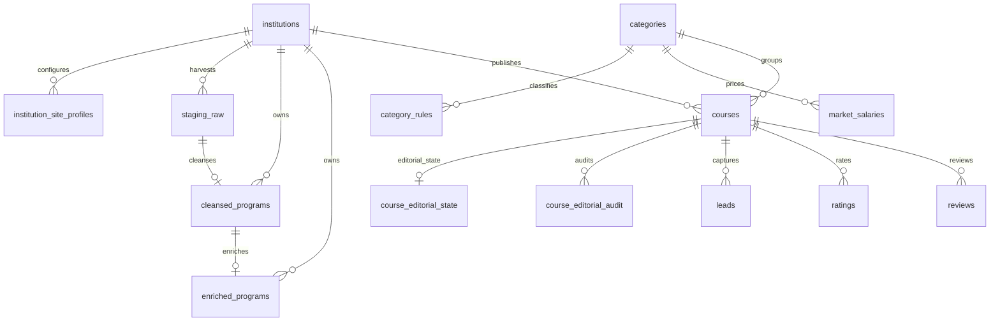
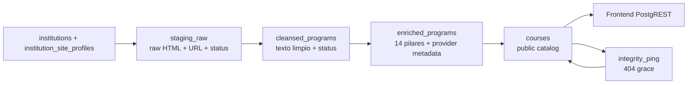

# Sistema DB Supabase

> Fuente canonica del modelo de datos, RLS, RPC, escritores y adopcion por ambiente. No autoriza DDL/DML ni operaciones remotas.
>
> **Referencia documental vigente para el código/schema local al 2026-10-12:** [database.md](database.md), [ledger local de migrations](componentes/database_migrations.md) y [estado operativo](estado_del_proyecto.md). Esta nota y sus registros de adopción quedan preservados con su fecha; los objetos SQL no demuestran el estado remoto. Pro sigue siendo el baseline autoritativo según AGENTS.md.

## Lectura vigente de este documento — 2026-10-07

El modelo/lineage siguiente conserva investigaciones y adopciones fechadas; snapshots de
gobierno antiguos no autorizan operaciones y filas «admin futuro» no describen el candidato
H3 ya implementado. Consultar [ficha de base de datos](database.md),
[migrations y contratos DB](componentes/database_migrations.md), el [registro fuente-componente](trazabilidad/registro_fuentes_componentes.json)
y estado vivo antes de
cambiar schema/RPC/writer. Esta revisión no inspeccionó DB remota; adopción se acredita
por evidencia ambiente, no por un SQL existente. Pro es baseline; PG17 fixture no DB operativa.
La tabla de writers normales de courses no habilita maintenance/bypass; cada excepción
requiere revisión/JIT. No restaurar masters SQL raíz ni copiar datos Free→Pro automáticamente.

## Cortes de investigación/adopción históricos

Snapshot de investigacion: `desarrollo@96c6e7e97a1a6c703eb3b5a3a22f6f6d21aa28e9`.
Snapshot GOV-CI10: `desarrollo@17d383291a5f2877074b54b66f2a0ff48a643667`, tree `e0029083e24016b97fc8896be3be2d4285414117`; sin cambios DB. PR #441 publico CI9 pero fallo post-merge con `POST_MERGE_ATTESTATION_DUPLICATE`; CI10 solo corrige gobierno CI y attestations. O3 posterior requiere R3 JIT explicito, reconoce Cloudflare Pages Production rebuild automatico y DB Sync detect-only con resultado obligatorio `NO_DB_CHANGES`.
Snapshot GOV-CI11: `desarrollo@cbdfe9dab373a2b427df4864b14427f3b2358789`, tree `99c1cda4f0091aaee35752caec69745051c41a3a`; sin cambios DB. CI11 solo corrige gobierno CI/promocion. O3 posterior requiere R3 JIT explicito, Cloudflare Pages app_id `85455` y `DB Sync Detect Only=NO_DB_CHANGES`; apply, DDL/DML y writers siguen prohibidos sin R3 separado.
Snapshot GOV-CI12: `desarrollo@793a2fb5aabc9e23bba2e3d36b47d6826444c5d4`, tree `bb3a9084961c090adac0d390aa22fdcc84670656`; sin cambios DB. CI12 solo corrige gobierno CI/promocion. La ruta O3 no-change exige `DB Sync Detect Only=NO_DB_CHANGES`, `db_changed=false`, `apply_executed=false` y prohibe report/apply/verify, DDL/DML, Supabase y credenciales Production.
Snapshot H2 Free DDL: rama local `feat/h2-editorial-model`; capa editorial H2 aplicada solo en Supabase Free con `editorial_field_definitions`, `course_editorial_state`, `course_editorial_audit` y `courses_public_effective`; sin Pro, backfill, writers, schedules ni deploys.

## Modelo De Datos

## Clasificacion De Tablas

| Tipo | Tablas | Politica |
|---|---|---|
| Catalogos/configuracion | `institutions`, `institution_site_profiles`, `categories`, `category_rules`, `market_salaries` | Viajan como SQL versionado y deben mantenerse en paridad por slug/regla/configuracion. |
| Operativas pipeline | `staging_raw`, `cleansed_programs`, `enriched_programs`, `courses` | No se copian Free -> Pro por flujo normal; cada ambiente las produce ejecutando FG2. |
| Publicas/producto | `courses`, `leads`, `ratings`, `reviews`, `institutions`, `categories`, `market_salaries` | Expuestas por PostgREST segun RLS/grants. |
| Auditoria/soporte | `email_log`, `schema_repair_audit`, `supabase_migrations` si existe | Uso operativo o de migraciones; no son contrato frontend. |

## Lineage Operativo

## Tablas Principales

| Tabla | Rol | Claves/Campos Relevantes | Escritores |
|---|---|---|---|
| `institutions` | Semillas institucionales | `id`, `name`, `slug`, `website_url`, telemetria harvest | FG1, harvester telemetry |
| `institution_site_profiles` | Configuracion de crawling/gates | `institution_id`, `pipeline_ready`, `pipeline_enabled`, `production_enabled`, `discovery_enabled`, exclusiones, circuit breaker | seed/profile tools, harvester control |
| `staging_raw` | Bronze/raw | `institution_id`, `url`, `raw_html`, `content_hash`, `status` | `universal_harvester.py`, cleansing status |
| `cleansed_programs` | Silver/clean | `staging_id`, `institution_id`, `url`, clean fields, `status` | `cleansing_worker.py`, enrichment status |
| `enriched_programs` | Gold/pre-public | `cleansed_id`, 14 pilares, provider metadata, `status` | `enrichment_worker.py`, sync status |
| `courses` | Producto publico | `institution_id`, `category_id`, `url`, `slug`, precio, modalidad, fechas, ROI, `is_active`, `is_verified` | `sync_vector_worker.py`, `integrity_ping.py` |
| `course_editorial_state` | Estado editorial H2 | `course_id`, `editorial_status`, `quality_status`, `manual_overrides`, `missing_fields`, `field_sources`, patrocinio, CTA y version | Backfill/admin futuro con JIT |
| `course_editorial_audit` | Auditoria editorial H2 | `course_id`, actor, accion, valores previos/nuevos, motivo y timestamp | RPC/admin futuro con JIT |
| `editorial_field_definitions` | Diccionario editorial H2 | `field_key`, `target_column`, ownership, required/public flags | Migracion/admin futuro con JIT |
| `leads` | Captura comercial | contacto, `course_id`, `lead_type`, campos de formulario | frontend publico si RLS permite |
| `ratings` | Rating social | `course_id`, `rating`, nickname, timestamp | frontend publico/autenticado segun RLS |
| `reviews` | Review social | `course_id`, contenido validado, timestamp | frontend publico/autenticado segun RLS |
| `categories` | Taxonomia | `id`, `name`, `description` | migraciones/catalogo |
| `category_rules` | Clasificacion | `category_id`, `keyword`, `priority` | migraciones/catalogo |
| `market_salaries` | ROI | salarios por categoria | migraciones/catalogo |

## RPC Y Funciones

| RPC/Funcion | Uso | Exposicion Esperada |
|---|---|---|
| `lock_staging_records` | Lock optimista de `staging_raw` | backend/service |
| `atomic_cleansing_promote` | Inserta `cleansed_programs` y marca staging procesado | `service_role` |
| `atomic_enrichment_promote` | Upsert provider-aware de `enriched_programs` | `service_role` |
| `increment_view_count` | Incremento desde frontend | publico si policy/grant lo permite |
| `fn_auto_assign_category` | Trigger de categoria | interno DB |
| `exec_sql` | Migracion/maintenance excepcional | restringido a `service_role`; no frontend |

## RLS Y Grants

- RLS esta habilitado para tablas publicas y ETL en el schema restaurado.
- La intencion vigente por migraciones endurecidas es que `courses` publico requiera `is_active=true`, `is_verified=true` y perfil `production_enabled=true`.
- `institution_site_profiles` solo expone minimamente `institution_id` y `production_enabled` cuando corresponde.
- Tablas ETL bloquean anon/authenticated y permiten escrituras solo con secret/service context.
- `leads`, `ratings` y `reviews` dependen de policies vigentes; si frontend escribe anon, el schema aplicado debe permitirlo explicitamente.
- RPCs privilegiadas revocan `PUBLIC`, `anon` y `authenticated` salvo excepcion documentada.

## Contrato De Credenciales

- Publishable keys comienzan con `sb_publishable_` y se usan para reads/frontend.
- Secret keys comienzan con `sb_secret_` y se usan solo en backend/CI autorizado.
- Las API keys van exclusivamente en `apikey`; nunca se envían como `Authorization: Bearer`. Los clientes Supabase de navegador, BFF y Edge eliminan el fallback Bearer del SDK cuando coincide exactamente con la API key.
- Excepción acotada aprobada para H3REQ1 el 2026-10-02: BFF server-side envía JWT de sesión solo al proyecto configurado, POST RPCs Admin allowlisted, GET/PUT Auth user, POST Auth factors y challenge/verify, DELETE factor con UUID válido y POST Edge admin-invite. Se evaluó una ampliación GET `/auth/v1/factors` el 2026-10-05, pero el SDK instalado (`@supabase/auth-js` 2.109.0) implementa `listFactors()` leyendo `user.factors` desde GET `/auth/v1/user`; por mínimo privilegio, la ruta extra no se habilitó y la aprobación quedó sin consumir. Edge solo puede reenviar JWT del solicitante a GET Auth user del mismo proyecto. Identidad desde cookie HttpOnly (BFF) o solicitud autenticada (Edge); sin JWT al navegador, tablas Data API, métodos/destinos arbitrarios ni redirects. La publishable key sigue en `apikey`; Supabase valida el JWT, service role no sustituye al usuario. Atestación sanitizada e inventario contractual registran el alcance; no autoriza operaciones remotas de Auth.
- Gateway RPC Admin H3REQ1 (contrato propuesto, **runtime aún no validado**): el BFF firma con `ADMIN_RPC_GATEWAY_HMAC_KEY` (>=32 bytes) y `ADMIN_RPC_GATEWAY_KEY_ID`, separados de `ADMIN_QUOTA_HMAC_KEY`. La expansión original firma metadata; `20261004_h3_admin_rpc_signed_gateway_payload_bound_wrapper.sql` firma también el JSON de args ligado al RPC objetivo. El transporte remapea únicamente RPC allowlisted a `public.admin_signed_rpc`; el dispatcher compara el payload firmado con `p_args`, valida keys y castea a las firmas tipadas originales sin SQL dinámico. Para `admin_get_course_queue_filtered`, el SQL `NULL` se rechaza antes de `LIMIT`; la migración forward-only `20261004_h3_admin_queue_first_null_guard.sql` actualiza la RPC ya aplicada o solo el snapshot privado si existe `H3_QUOTA_WRAPPER_V1`, y falla cerrada ante drift. El dispatcher convierte JSON `null` en sentinel entero acotado `0` por la RPC pública para conservar cuota, MFA/AAL2, RBAC y el error legacy, sin enviar SQL `NULL` a `LIMIT`. Al activarse el pre-request, `authenticated` solo puede invocar ese dispatcher; RPC legacy directas se rechazan y rutas service-role existentes se conservan. La identidad continúa en `auth.uid()` y las RPC originales aplican MFA/RBAC/RLS. Secretos espejo y nonces viven en `private.h3_admin_rpc_gateway_keys` y `private.h3_admin_rpc_gateway_nonces`, sin grants a roles API; el dispatcher valida firma, actor, proyecto, vigencia de 60 segundos y replay. Ninguna migración configura `pgrst.db_pre_request`, provisiona claves ni despliega. La secuencia EXPAND→compatibilidad→deploy→CONTRACT, activación, rollback y validación PG17/PostgREST requieren aprobaciones/JIT separados. El nonce es transaccional: tras rollback SQL se puede reintentar el proof, aunque el cupo BFF Durable Object permanece consumido. Esto solo cubre Data API/PostgREST, no Auth ni otros servicios Supabase. Estado 2026-10-04: revisión estática de seguridad sin hallazgos LOW+, runtime/JIT pendientes; NO-GO.
- Operaciones Free+Pro simultaneas deben exigir pares explicitos `FREE_*` y `PRO_*` y rechazar reutilizacion.
- BFF Admin H3REQ1: `ADMIN_SESSION_ACTIVITY_HMAC_KEY` es una clave server-side independiente (mínimo 32 bytes) de cuota y gateway. La cookie HttpOnly de actividad firma el timestamp con HMAC-SHA256; `GET /api/admin/session` solo renueva bajo `Sec-Fetch-Site: same-origin` y, si se envía `Origin`, exige que coincida. Provisionar esa binding en servicios remotos queda pendiente de autorización remota separada.
- Nunca documentar valores, project refs sensibles o tokens en este archivo.

## Adopcion Por Ambiente

La matriz vigente se mantiene en [Matriz Adopcion DB](operaciones/matriz_adopcion_db.md). Esta nota define el modelo esperado; la prueba final de adopcion requiere evidencias de migracion, CI y branch/environment.

## Fuentes De Schema

- `db/restore_full_schema.sql` es una base reconstruible, no necesariamente el estado terminal por si sola.
- El estado esperado debe interpretarse como restore schema mas `db/migrations/*.sql` en orden aplicable.
- Sin consultar el ledger remoto de Supabase no se afirma que todos los ambientes tengan todas las migraciones aplicadas.

## Drift Conocido

- Documentos legacy describian workers paralelos y writes directos a `courses`; el flujo vigente usa estaciones `staging_raw -> cleansed_programs -> enriched_programs -> courses`.
- Algunas policies de restore son mas amplias que las migraciones de hardening posteriores.
- La escritura frontend de ratings/reviews debe validarse contra RLS real antes de cambios funcionales.

## Mecanismo De Actualizacion

- Toda migracion, cambio RLS/RPC/grants o cambio de escritor debe actualizar esta nota.
- Cambios de flujo, workflow o runtime deben sincronizarse con [AGENTS: arquitectura del pipeline](../AGENTS.md#arquitectura-del-pipeline-4-estaciones--auditoría), la [ficha vigente de pipeline](componentes/pipeline.md) y el [índice principal](indice.md). La antigua nota `arquitectura_pipeline.md` no está en este checkout; no crear una autoridad paralela.
- Cambios por ambiente deben sincronizarse con [Matriz Adopcion DB](operaciones/matriz_adopcion_db.md).
